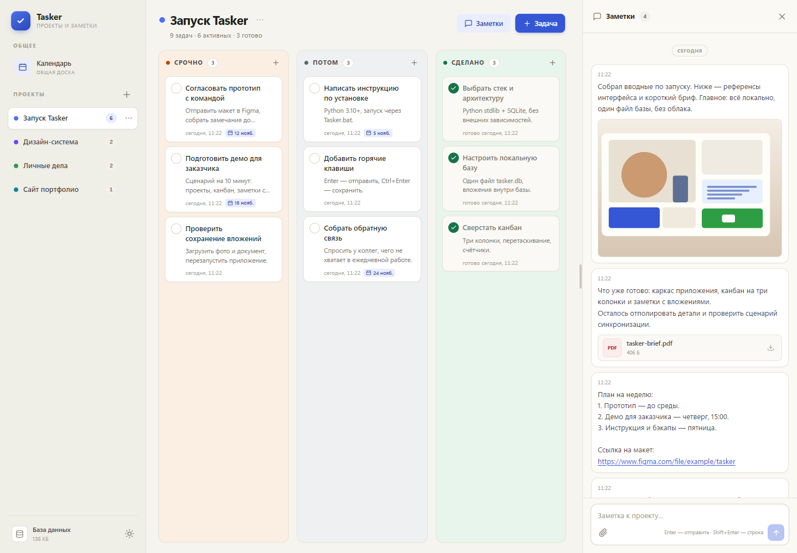
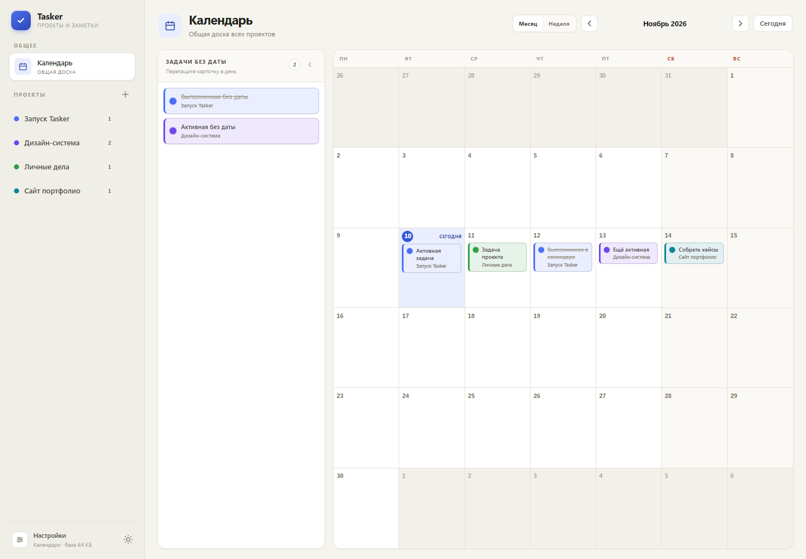
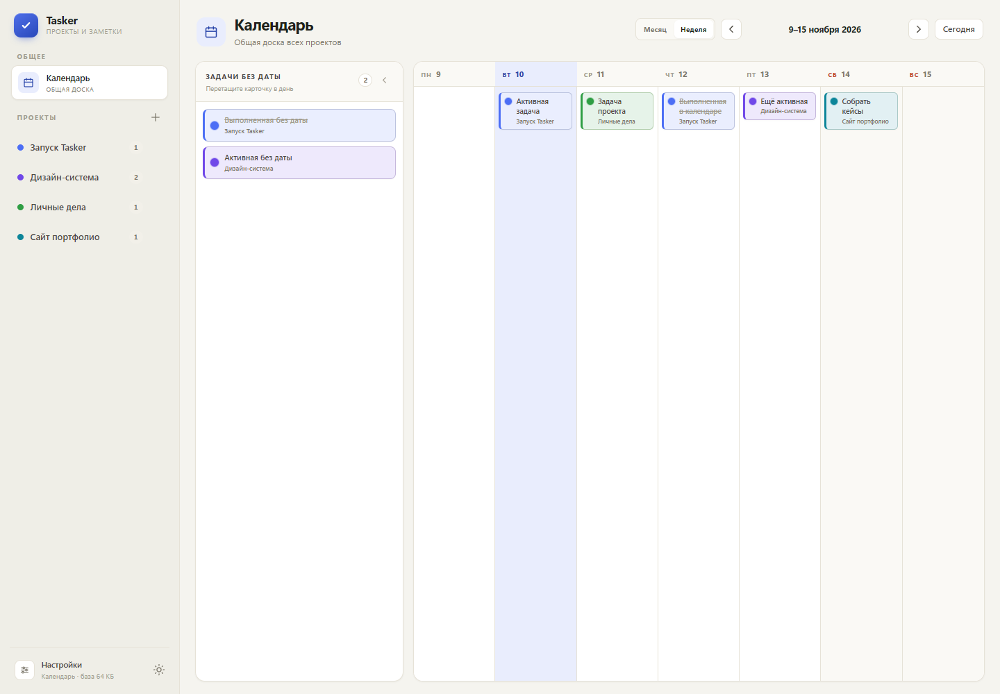
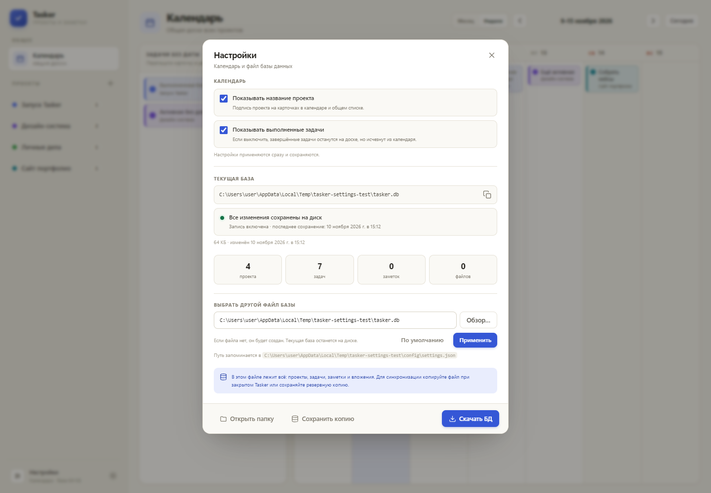
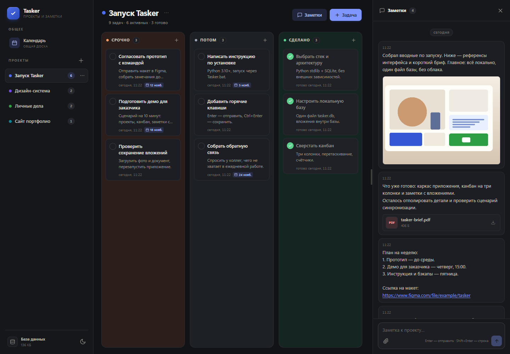

# Tasker

Локальный менеджер проектов: канбан-доска, общий календарь, заметки
с фото и файлами — и всё это в одном файле SQLite. Без аккаунтов, облака
и интернета.



## Что умеет

- **Проекты** — список слева, у каждого свой цвет и счётчик активных задач.
- **Канбан** — три колонки: «Срочно», «Потом», «Сделано». Задачи можно
  перетаскивать мышью, менять их порядок, редактировать и удалять.
- **Календарь** — два вида: **месяц** и **неделя**. Слева задачи без даты
  (список можно свернуть), справа сетка выбранного периода: карточку можно
  перетащить на день, перенести на другой день или вернуть в общий список.
  Задачи окрашены в цвет проекта: заливка карточки, цветная полоса, крупный
  кружок и подпись проекта. Двойной щелчок по задаче открывает её редактор,
  по пустому месту дня — новую задачу с выбором проекта. Дату также можно
  задать в редакторе задачи.
- **Заметки проекта** — чат справа от доски. Поддерживает текст, ссылки,
  фотографии (с просмотром на весь экран), документы и любые другие файлы.
  Файлы можно перетащить в панель, вставить из буфера обмена или выбрать
  через скрепку. Ширину панели можно менять перетаскиванием разделителя;
  она запоминается.
- **Свой путь к базе** — в окне «Настройки» можно выбрать любой файл
  `.db`, а приложение запомнит путь. Там же видно, существует ли файл,
  доступен ли он для записи и когда было последнее сохранение.
- **Настройки календаря** — чекбоксы «Показывать название проекта» и
  «Показывать выполненные задачи». Настройки применяются сразу и сохраняются
  между запусками.
- **Адаптивная боковая панель** — ширина колонки с названием приложения и
  проектами плавно меняется вместе с окном (от 190 до 285 px).
- **Один файл данных** — проекты, задачи, заметки и вложения лежат в
  `data/tasker.db` (или в выбранном файле). Файл можно скопировать,
  заархивировать или синхронизировать.
- **Резервные копии** — из приложения можно скачать целостный снимок базы
  или сохранить копию рядом с базой (по умолчанию в `data/backups/`).
- **Тема** — светлая и тёмная, выбор запоминается.
- **Portable-сборка** — один `Tasker.exe` для Windows, без установки Python
  и без командной строки: при запуске открывается браузер, при закрытии
  последней вкладки Tasker сохраняет базу и завершается.





## Варианты запуска

### 1. Готовый `Tasker.exe` — Windows x64, Python не нужен

`Tasker.exe` версии **1.5.0** — самодостаточная сборка около 10 МБ: внутри
Python, сервер и весь интерфейс. Ни Python, ни другие программы устанавливать
не нужно.

1. Скопируйте **`Tasker.exe`** в любую папку с правами на запись,
   например `D:\Tasker` или `Документы\Tasker`.
2. Запустите двойным щелчком. **Консольного окна нет** — сразу откроется
   браузер с приложением.
3. Чтобы завершить Tasker, просто закройте вкладку. Если открыто несколько
   вкладок Tasker, закройте последнюю: сервер сохранит базу, закроет
   соединение и завершит процесс.

При первом запуске рядом с exe создастся папка `data` с файлом `tasker.db`.
Чтобы перенести на другой компьютер уже существующие проекты, скопируйте
`Tasker.exe` **вместе с папкой `data`** (или положите свой `tasker.db`
в `data` рядом с exe). Путь к базе можно изменить в приложении — он
запоминается в `%APPDATA%\Tasker\settings.json`.

Если браузер не открылся, Tasker покажет окно с ошибкой и завершится.
Диагностический журнал лежит в `%APPDATA%\Tasker\tasker.log`.

> Windows может показать предупреждение SmartScreen, потому что exe не подписан
> цифровым сертификатом. Нажмите «Подробнее» → «Выполнить всё равно».
> Exe ничего не устанавливает в систему и не требует прав администратора.
> Некоторые антивирусы могут ложно срабатывать на неподписанные
> PyInstaller-сборки — при сомнении пересоберите exe скриптом `build_exe.bat`.

Сборка предназначена для **Windows 10/11 x64**. Для macOS и Linux используйте
запуск из исходников.

### 2. Из исходников — Python 3.10+

Нужен Python 3.10+ (проверено на 3.13 и 3.14). Больше ничего устанавливать
не нужно — только стандартная библиотека.

```powershell
cd D:\Projects\Code\tasker
python server.py
```

Либо дважды щёлкните **`Tasker.bat`** — он найдёт Python и запустит сервер.

Сервер печатает адрес, например `http://127.0.0.1:8765/`, и открывает браузер.
Если порт занят, Tasker сам выберет следующий свободный. При запуске из
исходников закройте вкладку или нажмите `Ctrl+C` в консоли — в обоих случаях
база закрывается корректно.

### Параметры

Параметры одинаковые у `python server.py` и `Tasker.exe`:

```powershell
python server.py --port 9000
python server.py --db "D:\YandexDisk\Tasker\tasker.db"
python server.py --no-browser
python server.py --auto-shutdown

Tasker.exe --db "D:\YandexDisk\Tasker\tasker.db"
```

| Параметр | Что делает |
|---|---|
| `--port N` | Порт; по умолчанию 8765 |
| `--db PATH` | Путь к файлу базы; переопределяет сохранённый в настройках |
| `--no-browser` | Не открывать браузер автоматически |
| `--auto-shutdown` | Завершать сервер после закрытия последней вкладки; включается само, когда Tasker открывает браузер |
| `--host 0.0.0.0` | Слушать не только локальный интерфейс (осторожно) |
| `--version` | Показать версию |

Если запустить с `--no-browser` без `--auto-shutdown`, автоматическое
завершение по вкладке отключено: сервер работает, пока его не остановить
(`Ctrl+C` в консоли). Для exe без консоли этот режим не предназначен.

## Где лежат данные

- по умолчанию при запуске из исходников — **`data/tasker.db`** рядом
  с `server.py`;
- по умолчанию при запуске `Tasker.exe` — **`data/tasker.db`** рядом с exe;
- путь можно изменить в приложении: **«Настройки» → «Выбрать другой файл
  базы»**. Новый путь запоминается в `%APPDATA%\Tasker\settings.json` и
  используется при следующих запусках. `--db` имеет приоритет над настройками.

Точный путь, размер и состояние записи видны в окне «Настройки» —
кнопка «Настройки» в левом нижнем углу.

В этом файле находится **всё**, включая фотографии и документы из заметок:
отдельной папки с вложениями нет. Это делает копирование и синхронизацию
простыми — но и файл растёт вместе с вложениями.

При первом запуске версии 1.1+ база автоматически обновляется: в задачах
появляется дата календаря. Существующие проекты, задачи, заметки и вложения
не перезаписываются.

### Запись и сохранность

Приложение держит **одно соединение с базой на время работы** и закрывает
его при штатном завершении. Каждое изменение сразу подтверждается (`COMMIT`,
`journal_mode=DELETE`, `synchronous=FULL`), поэтому после ответа интерфейса
данные уже лежат на диске. Если процесс завершить аварийно, SQLite откатит
незавершённую транзакцию при следующем открытии — уже сохранённые проекты,
задачи и файлы не пострадают.

В окне «Настройки» статус показывает:
- существует ли файл и доступен ли он для записи;
- когда была последняя запись;
- что все изменения сохранены на диск.

### Завершение

Каждая вкладка держит служебное SSE-соединение с сервером. Когда закрывается
последняя вкладка, Tasker ждёт несколько секунд (чтобы перезагрузка страницы
не выключала сервер), затем закрывает базу и завершается. Перезагрузка
вкладки, работа в нескольких вкладках и восстановление страницы из кэша
учитываются. Если браузер был закрыт аварийно, сервер замечает обрыв
соединения сам.

Для сборки без консоли журнал пишется в `%APPDATA%\Tasker\tasker.log`.



### Синхронизация

1. Закройте Tasker (закройте вкладку; при запуске из консоли также можно
   нажать `Ctrl+C`).
2. Скопируйте текущий файл базы (его путь виден в «Настройках») в облако /
   на другой компьютер.
3. На другом компьютере выберите этот файл в «Настройках» или запустите
   Tasker с явным путём:
   `Tasker.exe --db "путь\к\tasker.db"`.

Если приложение запущено, не копируйте файл «на живую»: используйте кнопку
**«Сохранить копию»** или **«Скачать БД»** — они делают согласованный снимок.

Важно: Tasker не объединяет изменения. Не редактируйте одну базу на двух
компьютерах одновременно — синхронизируйте файл по очереди.



## Горячие клавиши

| Где | Клавиши | Действие |
|---|---|---|
| Быстрое добавление задачи | `Enter` | Добавить задачу |
| Быстрое добавление задачи | `Shift+Enter` | Перенос строки |
| Быстрое добавление задачи | `Esc` | Закрыть поле |
| Редактор задачи / заметки | `Ctrl+Enter` | Сохранить |
| Заметки | `Enter` | Отправить |
| Заметки | `Shift+Enter` | Новая строка |
| Любое окно | `Esc` | Закрыть |
| Карточка задачи | Двойной щелчок | Открыть редактор |
| Карточка задачи | `Enter` | Открыть редактор |
| Задача в календаре | Двойной щелчок | Открыть редактор |
| Пустое место дня | Двойной щелчок | Новая задача на этот день |
| Задачи без даты | Кнопка-шеврон | Свернуть или показать список |

Перемещать задачи можно не только мышью: меню «⋯» на карточке содержит
команды «В „Срочно“», «В „Потом“», «В „Сделано“». Дату можно задать
перетаскиванием в календаре или через поле «Дата в календаре» в редакторе
задачи.

В календаре переключатель **«Месяц / Неделя»** меняет вид. Стрелки листают
текущий период, «Сегодня» возвращает к текущему месяцу или неделе. Неделя
начинается с понедельника; на узких экранах она прокручивается по горизонтали.

## Тесты

```powershell
python tests\smoke_test.py
python tests\storage_test.py
python tests\lifecycle_test.py
```

`smoke_test.py` поднимает временный сервер и проверяет API: проекты, задачи,
перемещение, даты календаря, заметки с вложениями, пагинацию, резервные
копии, каскадное удаление, перезапуск и сохранность файла.

`storage_test.py` проверяет смену файла базы и настройки: выбор нового пути,
сохранение его в настройках, отказ для не-SQLite и чужой базы, возврат к
прежней базе, запуск без `--db` с уже сохранённым путём, а также сохранение
настроек календаря между запусками.

`lifecycle_test.py` проверяет завершение сервера: пока вкладка открыта, он
работает; перезагрузка не выключает его; после закрытия последней вкладки
процесс завершается с кодом 0 и база остаётся на диске. Внешние зависимости
не нужны.

Сборка дополнительно проверена в режиме без Python в `PATH`: запуск из чистой
папки, работа интерфейса из встроенных ресурсов, вложения, резервные копии и
перенос всей папки на «другой компьютер». Отдельно проверены windowed-сборка
без консольного окна, автоматическое открытие браузера, переключение базы и
завершение процесса после закрытия вкладки.

## Сборка exe

Готовая сборка уже лежит в корне проекта. Пересобрать её можно скриптом
**`build_exe.bat`**: он создаст временное окружение, установит PyInstaller
и соберёт новый `Tasker.exe` с иконкой и версией. Сборка идёт в режиме
**без консоли** (`--windowed`): при запуске сразу открывается браузер.

```powershell
build_exe.bat
```

Для сборки нужен Python 3.10+ и интернет при первом запуске (скачивается
PyInstaller). На работу готового exe это не влияет.

## Устройство

```
Tasker.exe             готовая portable-сборка для Windows x64
build_exe.bat          пересборка exe без консоли
assets/                иконка и метаданные exe
server.py              запуск, выбор порта, браузер, журнал
tasker/db.py           SQLite: одно соединение, схема, запросы, бэкапы
tasker/lifecycle.py    завершение после закрытия последней вкладки
tasker/settings.py     путь к базе и настройки календаря
tasker/filedialog.py   системный выбор файла базы в Windows
tasker/http.py         HTTP-сервер, REST API и SSE-канал вкладки
web/                   интерфейс без сборки: HTML, CSS, ES-модули
  js/app.js            состояние, проекты, календарь, тема, окна
  js/board.js          канбан и drag & drop
  js/chat.js           заметки, вложения, лайтбокс
  js/calendar.js       общий календарь и перетаскивание задач по дням
  js/lifecycle.js      SSE-канал и закрытие вкладки
  js/task-editor.js    редактор задачи из календаря
  js/ui.js             модальные окна, меню, форматирование
tests/smoke_test.py    smoke-тесты API
tests/storage_test.py  тесты смены файла базы и настроек
tests/lifecycle_test.py тесты завершения по вкладке
Tasker.bat             запуск из исходников на Windows
data/tasker.db         создаётся при первом запуске
```

По умолчанию сервер слушает только `127.0.0.1` и не отправляет данные наружу.
База использует журнал `DELETE`, поэтому после закрытия приложения рядом
остаётся только один файл `.db` — его удобно синхронизировать.

## Ограничения

- Однопользовательское приложение: совместная работа в реальном времени не
  поддерживается.
- Одновременно должен работать один экземпляр Tasker на одну базу. Не
  открывайте одну и ту же базу двумя копиями приложения одновременно.
- Автоматической синхронизации нет — только файл базы или резервные копии.
- Путь к базе и настройки календаря хранятся в профиле Windows
  (`%APPDATA%\Tasker\settings.json`) и не переносятся вместе с папкой
  приложения; на новом компьютере их нужно выбрать заново.
- Нет поиска по всем проектам и напоминаний о сроках.
- `Tasker.exe` собран только для Windows x64; на других ОС запускайте из
  исходников.
