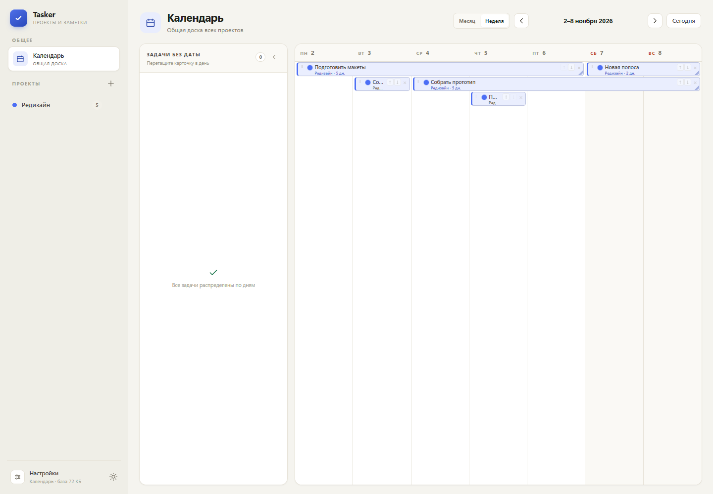
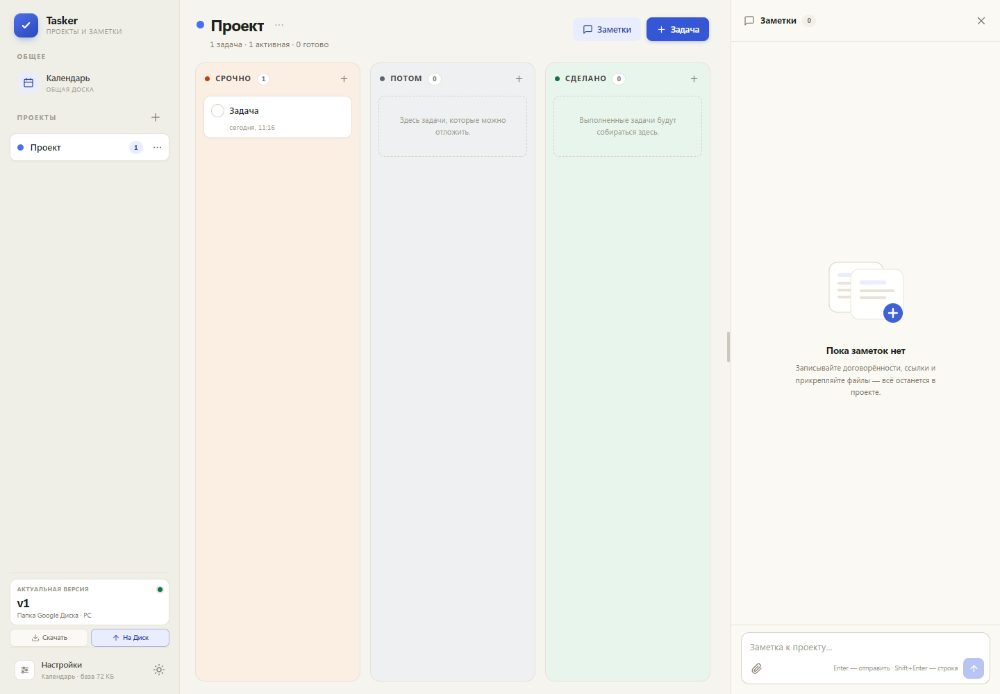

# Tasker

Локальный менеджер проектов, задач и заметок для одного пользователя.
Работает как обычное Windows-приложение: открывает интерфейс в браузере,
хранит данные в SQLite и не требует аккаунта или постоянного подключения
к интернету.

**Версия 1.11.0** · Windows 10/11 x64 · Python 3.10+ для запуска из исходников

[Полная документация](about.md) · [Подключение Дисков](connection.md) · [Новый компьютер](new-device.md)

## Возможности

- **Канбан-доска** — «Срочно», «Потом», «Сделано», drag & drop, ручной
  порядок задач и проектов.
- **Календарь** — месяц и неделя, задачи без даты, перетаскивание по дням,
  задачи на несколько дней и упаковка строк «как в тетрисе». Длинная задача
  не разрывается между строками, а порядок строк задаётся вручную.
- **Заметки проекта** — текст, ссылки, изображения и любые файлы.
- **Текстовая база + папка файлов** — лёгкая SQLite-база отдельно от
  тяжёлых вложений.
- **Резервные копии** — ZIP-архив с базой и всеми файлами.
- **Синхронизация** — вручную через папку Google Диска, Google Drive API
  или Яндекс Диск.
- **Быстрая синхронизация** — кнопки «Скачать» / «На Диск» и виджет
  актуальной версии над «Настройками».
- **Темы** — светлая и тёмная.
- **Portable exe** — без установки Python, консоли и прав администратора.

## Скриншоты






## Быстрый старт

### Готовый `Tasker.exe`

1. Скопируйте `Tasker.exe` в папку с правами на запись.
2. Запустите двойным щелчком.
3. Откроется браузер; рядом появится `data/tasker.db` и `data/tasker_files/`.
4. Для завершения закройте последнюю вкладку Tasker.

Windows SmartScreen может предупредить, что exe не подписан: «Подробнее» →
«Выполнить всё равно».

### Из исходников

Нужен только Python 3.10+:

```powershell
python server.py
```

или запустите `Tasker.bat`. Внешних библиотек нет.

## Синхронизация

Обмен только ручной: «Отправить на Диск» заменяет версию на Диске,
«Скачать с Диска» заменяет локальные данные. Перед скачиванием создаётся
резервная копия.

| Способ | Что нужно |
|---|---|
| Папка Google Диска | Google Drive для компьютера |
| Google Drive API | OAuth Client ID/Secret, подключение в браузере |
| Яндекс Диск | OAuth-токен |

Подробные инструкции, права доступа и разбор ошибок:
[connection.md](connection.md).

Как получить данные на втором компьютере:
[new-device.md](new-device.md).

## Где лежат данные

```text
Tasker.exe
data/
  tasker.db
  tasker_files/
  backups/
```

Путь к базе можно изменить в настройках. Папка вложений переезжает вместе
с базой и называется `<имя базы>_files`.

## Документация

| Файл | Для чего |
|---|---|
| [about.md](about.md) | Полная документация: возможности, формат данных, API, архитектура, тесты, ограничения |
| [connection.md](connection.md) | Подключение Google Диска и Яндекс Диска, токены, ошибки |
| [new-device.md](new-device.md) | Настройка нового компьютера и получение базы с Диска |

## Технологии

- Python 3.10+ только со стандартной библиотекой;
- `ThreadingHTTPServer`, SQLite;
- HTML/CSS/ES-модули без сборщика;
- PyInstaller для сборки Windows exe.

## Сборка

```powershell
build_exe.bat
```

Скрипт создаёт `Tasker.exe` без консоли. Требуется Windows x64 и Python.

## Тесты

```powershell
python tests\smoke_test.py
python tests\storage_test.py
python tests\lifecycle_test.py
python tests\files_sync_test.py
python tests\yandex_mock_test.py
```

На версии 1.11.0 smoke-тест содержит **79 проверок**. Отдельный тест
Яндекс Диска работает на локальном mock-сервере, без реального аккаунта.

## Ограничения

- один пользователь и один экземпляр Tasker на одну базу;
- нет автоматической синхронизации и слияния изменений;
- нет поиска по всем проектам и напоминаний;
- Windows-сборка только x64;
- токены Google/Яндекс хранятся в `%APPDATA%\Tasker\settings.json`;
- Яндекс Диск в режиме токена не обновляет токен автоматически.

## Структура

```text
tasker/       SQLite, HTTP API, синхронизация, настройки
web/          интерфейс: HTML, CSS, JS-модули
tests/        API, хранилище, жизненный цикл, синхронизация
assets/       иконка и метаданные exe
data/         база, файлы и резервные копии
```
